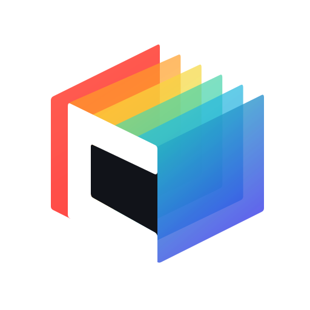

  

<h1 align="center">ChroViewer</h1>

> [!CAUTION]
> While this ChroViewer fork have the option for utilizing AI models for presenting gameplay, **no AI models are included** within this fork.
  
> [!WARNING]
> Neither MOS, the org, nor staff-team, will provide any support/guidance in how to use this fork.  
> This fork is made and maintained solely for MOS use-cases, nothing else.

"MOSViewer", refering to this fork, is modified version of the [ChroViewer-project](https://github.com/Umbranoxio/chroviewer) by Umbranox, based on this [chroviewer](https://github.com/ServerBP/chroviewer)-fork.

Outside of utilizing the Replay-streaming components from Luna's ChroViewer, we've additionally added multiple "Clean" environments, changed sabers etc.

"MOSViewer" also contains a version of ChroViewer, completely stripped down to what's needed.

To use that version, use the `/overlay`-path. It accepts the same parameters as the default path.

## Getting Started

See [SETUP.md](SETUP.md) for the local development guide

## Contributing

See [CONTRIBUTING.md](CONTRIBUTING.md) for code standards and pull request expectations

## Attribution and License

ChroViewer's environment data, preview math, shaders, materials, lighting and related rendering code are derived from [ChroMapper](https://github.com/Caeden117/ChroMapper) by Caeden117 and contributors under GNU GPL v2. Caeden117 approved this preview-side porting work

ChroViewer is distributed under [GNU GPL v2](LICENSE) (`GPL-2.0-only`)

Third-party asset attributions are listed in [ATTRIBUTIONS.md](ATTRIBUTIONS.md)

ChroViewer is an unofficial community project. It is not affiliated with or endorsed by Beat Games, Meta, ChroMapper or BeatSaver. Any Beat Saber names / assets belong to their respective owners
